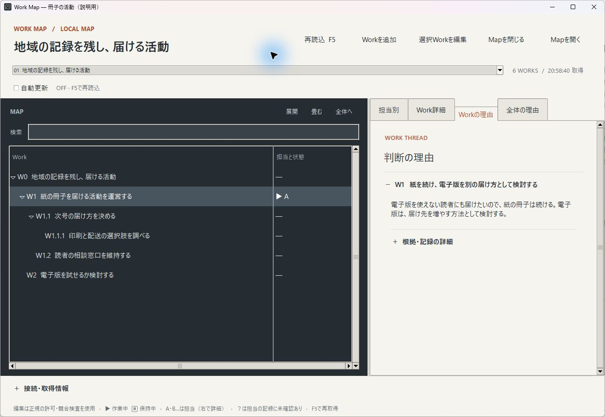

# Work Map／Work Thread

Windowsで使う、個人向けローカル試用版です。

**やることは分かる。でも、なぜやるのか、変えてよいのかが分からない。**

引き継いだ作業の一覧はあるのに、前の担当がその方法を選んだ理由が見つからない。AIに頼んだ作業は進んでいるけれど、最初に実現したかったことへ近づいているのか気になる。思い付いた案は残しておきたいが、全部を今やる仕事として抱えたくはない。

Work Map／Work Threadは、**仕事の目的と判断の理由を残し、その目的を軸に次を選ぶための道具**です。中心にあるのは、それぞれの仕事が「何のために存在するか」という目的（**Intent**）。今の作業を続けるか、別の方法を試すか、役目を終えた仕事を閉じるかを考える基準にします。

- **Work Map**は、現在の仕事・目的・つながり・担当・許可を見る地図です。
- **Work Thread**は、その仕事で「なぜそう判断したか」を後から辿れる記録です。

人とAIが同じ情報を使い、判断を引き継ぐ材料にします。AIなしでも、人間だけで利用できます。作業の先の目的へ戻ると何が変わるか、一つの活動を例に見てください。

## 例えば、地域の歴史を冊子にして届ける活動なら

ここからは説明のための架空例です。地域の歴史を小さな冊子にまとめ、読者へ配っている活動を考えます。

担当者には、印刷費を調べる、配送方法を決める、読者の相談に答える、といった仕事があります。作業の一覧だけを引き継ぐと、次の担当も印刷や配送の改善を続けるでしょう。

ところが、この活動で実現したかったのは、冊子を作ること自体ではなく、**地域の記録を、より多くの人が読める形で残し、届けること**でした。

### 1. 作業から、その先の目的へ戻る

活動全体の目的と、それを支える個々の仕事のつながりを残しておくと、「印刷を安くする」だけでなく、「遠方の人や、電子で読みたい人にも届ける方法はないか」と考えられます。

そこで、電子版を試せるか調べる案を、今ある活動と並べて置きます。この道具では、目的を持つ仕事・活動・検討案を、一つずつ **Work** と呼びます。電子版の案を加えた時点では、例えば次のような地図になります。

```text
W0 地域の記録を残し、届ける活動
├─ W1 紙の冊子を届ける活動を運営する
│  ├─ W1.1 次号の届け方を決める
│  │  └─ W1.1.1 印刷と配送の選択肢を調べる
│  └─ W1.2 読者の相談窓口を維持する
└─ W2 電子版を試せるか検討する
```

W0・W1などは、画面やコマンドでも使う、Workを指し示す表示IDです。優先順位や作業の順番を表すものではありません。

細かい仕事（W1.1.1の調査など）から、それが支える大きな活動（W0）へ戻る。このつながりを使って、**目的を保ったまま、進み方を変え、新しい仕事を考えられる**ことが魅力です。人や担当AIが、目的と根拠から次の手段を選びます。

### 2. 案を残すことと、引き受けることを分ける

電子版の案（W2）を登録しても、紙の冊子を担当している人が、その制作まで引き受けたことにはなりません。誰が何を引き受けているかは、地図上の **Pin**という目印で区別します。引受とは別に、試作や公開で何をしてよいかという許可も確認します。

**忘れないために案を残すことは、今すぐ実行する約束ではありません。** 検討して今回は見送るなら、必要な確認を経て、理由を残して閉じられます。現在の地図から外した後も、なぜ見送ったかを辿れます。

### 3. 結果だけでなく、選んだ理由を残す

印刷の見積りや読者の利用状況は、結果資料としてつなぎます。調べた結果、「電子版を使えない読者にも届けたいので、紙の冊子は続ける。電子版は届け先を増やす方法として検討する」と判断したら、その理由をWork Threadへ残します。

「調査した」という操作の記録や見積りの数値と、「なぜ費用だけで紙をやめなかったか」という理由を分けます。調査が終わっても、読者の相談窓口や電子版の検討まで終わったことにはしません。

### 4. 後から来た担当も、判断し直せるようにする

半年後、会話を知らない担当へ「電子版だけにしてよいか」という相談が来たとします。担当はMapで現在の活動・目的・担当を確認し、Threadから紙を続けた理由と当時の根拠へ戻れます。

当時の見積りや読者の状況を、今も同じとは扱いません。「今も電子版を使えない読者がいるか確かめよう」「状況が変わったなら届け方を見直そう」と、次に必要な確認を選べます。

**前の担当の結論に従うためだけでなく、何を守ろうとしたかを理解し、今の判断をするために理由を残します。** 会話を覚えている人がいなくても、当時の理由と根拠から考え始められます。

上の架空例を、この試用版で開いた画面です。左で仕事のつながりを見渡し、右で選んだ仕事の判断理由を読みます。紙の活動には架空の担当者のPinがあり、電子版の案はまだ誰も引き受けていません。



## 小さな作業も、続く活動も、まだ決めていない案も

Workは、**なぜ存在するのかという目的を持ち、続け方・変え方・終え方を考えたい対象**です。終わりのある作業も、継続する活動も、まだ採用を決めていない案も含みます。

| 表したいもの | 例えば、何のために存在するか |
|---|---|
| 会社・事業・部署 | どんな価値を生み、何を担い続けるのか |
| サービス・継続業務 | 誰に、どんな状態を届け続けるのか |
| 研究・学び・暮らしの活動 | 何を明らかにし、何を身に付け、どんな生活を支えるのか |
| プロジェクト | 何を変え、何を成立させたいのか |
| 気になる案・検討したいこと | なぜ確かめてみたいのか |
| 小さな作業 | 大きな目的のどの部分を進めるのか |

表の分類は説明用で、データ上は同じWorkです。大きな活動から小さな作業まで、目的とつながりを使って辿れます。

## 地図と記録に、何を残すのか

新しいWorkには、名前、目的（Intent）、生まれた理由・きっかけ（**Origin**）を残します。電子版の例なら、「届ける方法を増やせるか確かめたい」が目的、「読者から要望があった」がきっかけです。

Mapには、Work同士のつながりと、今の担当・許可・行動に効く取り決めがあります。

| 名前 | 表すこと |
|---|---|
| Parent／Child（親Work／子Work） | 大きな活動と、その一部を担う仕事の関係。例では「紙の冊子を届ける活動」が「次号の届け方を決める」の親Workです。 |
| Dependency | 別の仕事の成果などを必要とする関係。 |
| Pin | 誰が何を引き受けているか。activeは現在の主作業、heldは引受を保ち、今の主作業ではない状態。 |
| Permission | 何をしてよいかという許可。引き受けたことから実行許可を推測しません。 |
| Action Rule（行動ルール） | 行動の順序・時期・再確認などに効く、現在の取り決め。 |

次の一手を固定した一覧を正解として持つのではなく、その時の地図から判断します。

ThreadはWorkが生きている間から育ちます。選んだ理由、守ろうとしたこと、分かったこと、見直す条件など、**半年後に失っていたら、変える・止める・戻す・再開する判断に困ること**を残します。

すべての操作を書き残す必要はありません。名前や目的を何度も写す手間をかけず、後で判断に迷いそうな理由を残します。調査結果や見積りは資料へつなぎ、必要になった時に読み直せます。具体的な使い分けと操作は[手順書](USAGE.md)で調べられます。

閉じたWorkは現在Mapから退き、名前・最終の目的・出自・終了理由・後へ残したものをThreadから辿れます。当時の許可や事実が今も有効かは、現在の地図と根拠で確かめます。

## 人とAIが、同じ仕事を理解するために

**仕事の続きが、特定の人やAIの会話だけに閉じないようにする設計です。** 人が画面で目的や根拠を確かめ、許可に従って訂正したら、AIが次に読む時も同じ保存データを使います。同じPCのデータを読める次の担当も、Mapと必要なThread・根拠から理解を始められます。

AIが日常的に読む・判断する・更新することを初めから考え、目的や関係を構造化し、必要な情報を少しずつ辿り、通常の操作で更新できるようにしています。この意味での**AIネイティブ**です。

| 起き得るミス | この仕組みが助けること |
|---|---|
| 目の前の小作業をこなすことが目的になる | 大きな目的へ戻り、必要な別の手段やWorkを考える材料を渡す |
| 「登録された」「担当した」から、実行してよいと思う | Workの存在、Pinによる引受、Permissionによる許可を分ける |
| 分からないことを「ない」「完了した」と補う | 未確認と、確認した結果何もない状態を区別する |
| 古い会話の内容で、新しい情報を上書きする | 読んだ版・変更前の値・関連する根拠を確認し、前提が変われば止める |
| 担当が替わるたび、理由を推測し直す | 同じMapと必要なThread・根拠から、判断のつながりを受け取れるようにする |

更新時には許可や変更前の値を照合し、食い違う時は、その変更を反映せずに止め、知らせます。AIは必要な現在情報から読み始め、理由が必要な時だけThreadや根拠を辿れます。毎回すべての資料を渡さずに、判断を引き継ぐための仕組みです。

## なぜ作ったのか

出発点は、「Workには必ず『なぜ』があり、生まれた時からそれを保てば、後から理由を失うことを減らせるのではないか」という仮説でした。仕事の一覧だけでなく、目的と、過去・現在・これからのつながりそのものが、判断するための足場になるのではないかと考えたのです。

やってみたいと思ったことを、忘れて、無かったことにしたくない。考えた末にやらないと決めたなら、その理由を残して、ちゃんと閉じてあげたい。始めた理由も、途中で考え直した理由も、その仕事が存在した意味として辿れるようにしたいと思いました。

最初は小さなタスクツリーでした。でも、目的を持つWorkをつないでいくと、作業だけでなく、活動もサービスも会社も、一つの世界の地図として表せるようになってきました。その地図へ戻れば、今のやり方に縛られず、本当に実現したかったことのために、次を選び直せるのではないか。

半年後、理由も文脈も薄れた時に、「Work MapとWork Threadがあったから思い出せた。戻れた。もう一度判断できた」と言えるものにしたい。人もAIも、同じ地図と理由を見ながら、仕事の続きを考えられるようにしたい。

そして、そのための管理が本来の仕事より重くなってしまっては、作る意味がありません。普段は気軽に使えて、困った時には戻る場所になる。そんな道具を目指して作っています。

名前については、[名前の由来](NAME_ORIGIN.md)へ。

## この試用版で使えること

各Mapは、現在のデータを一つの保存先（正本）で管理します。画面とコマンドは、その同じデータを読み書きします。

ボタンや入力欄を使う画面操作（GUI）と、文字で操作を指定するコマンドを使い分けます。最初の設定もコマンドで行います。

- 画面で複数Mapを切り替え、Workの木・詳細・担当別表示・Threadを見る。
- 画面で、許可と確認を経て名前・目的・出自を訂正し、Workを追加する。
- コマンドで、本人Pinの切替、必要な理由と結果の記録、通常の終了手続きを行う。人間もコマンドを使えます。
- 画面の自動更新（再読）、バックアップ、保存結果が不明な時の再確認、保全したバックアップからの明示的な復旧を使う。

## 使い始める

最初は、実際に扱っている活動と、そこから生まれた少数のWorkで始められます。すべてを細かく分割する必要はありません。

AIと一緒に使う場合は、このPCの保存データと同梱コマンドを扱える環境が必要です。

1. ZIPを同期対象外のローカルフォルダへ展開する。
2. Python 3.11以上と、画面表示に使う標準機能のTkinterを用意する。確認方法は[手順書](USAGE.md#最初にすること)にあります。追加ライブラリやAIサービス契約は不要です。
3. [初期設定](USAGE.md#最初にすること)のコマンド例を自分の目的ときっかけに合わせて実行し、最初のWorkを作る。
4. [画面を開き](USAGE.md#guiで開く)、現在と理由を見ながら使う。

まずは、最初のMapを作って画面を開くだけで始められます。閲覧のための許可設定は要りません。追加や訂正をしたくなった時に、必要な操作を設定します。

必要な操作だけを調べる：[追加・Pin・理由・結果・終了・復旧の手順](USAGE.md)。配布物の範囲と確認結果：[更新説明](RELEASE_NOTES.md)。

### この版を試す環境

一人のWindows PCで、同期対象外のローカルフォルダに保存して使います。同じPCのデータを次の担当も読めることを前提にしています。**新しいフォルダと空のMapから始めてください。**

会社PCでの適合、Windows Python 3.11での実行、既存データの移行、別PCへの受け渡し、長期利用の効果、組織全体での運用は、これから確かめる範囲です。この配布はMapの切出し・再統合や複数PC共同更新を提供していません。

実際の環境や仕事で、どこまで役に立つかを試せる段階の版です。

改良できるプログラム一式も同梱しています。仕組みを育てる人向けの説明は[引渡し資料](HANDOVER.md)へまとめています。

コード等は[MIT](LICENSE)、説明文書は[CC BY 4.0](LICENSE-DOCS.md)です。範囲と著作者表示は[NOTICE](NOTICE.md)に記載しています。公開された版は[GitHub Releases](https://github.com/Bourbon-OS/workmap-personal-starter/releases)で確認できます。
